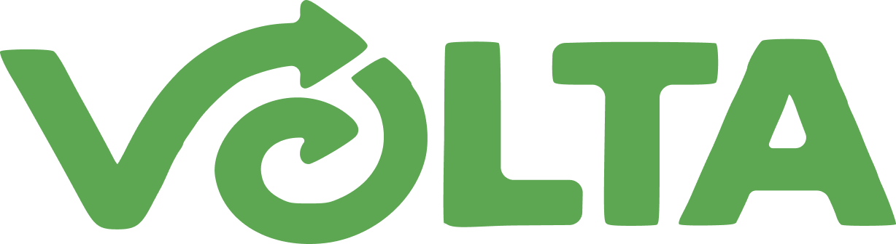
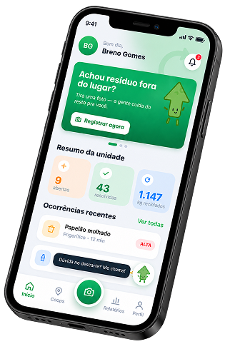
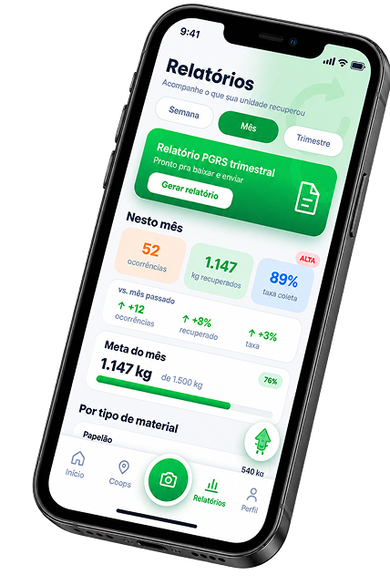
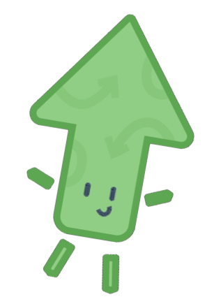

<div align="center">



### *"Tudo que vai, VOLTA"*


[Ver o site](https://app-volta.github.io/volta-landing-page-static/src/) •
[A ideia](#-a-ideia) •
[Desenvolvimento 1](#-desenvolvimento-1) •
[Páginas](#-páginas-do-projeto) •
[Tecnologias](#-tecnologias) •
[Como executar](#-como-executar) •
[Equipe](#-equipe)

</div>

---

## 💡 A ideia

**VOLTA** é uma plataforma que conecta empresas e cooperativas de reciclagem para facilitar o gerenciamento e o direcionamento de resíduos plásticos. O VOLTA organiza a relação entre quem gera o resíduo e quem pode dar a ele um destino adequado.

<div align="center">

```
EMPRESA  ->  VOLTA  ->  COOPERATIVA
```

</div>

Projeto Interdisciplinar do Instituto J&F Germinare Tech. Este repositório contém a parte web da disciplina **Desenvolvimento 1**: a landing page e as telas web do CRUD.

**Problema.** Empresas têm dificuldade de saber o que geram, qual o destino adequado, quais cooperativas podem receber o material e como acompanhar as coletas. Cooperativas têm dificuldade de encontrar empresas e de manter uma comunicação eficiente.

**Solução.** Uma plataforma em que a empresa se cadastra e encontra cooperativas, e a cooperativa informa o que recebe e espera o contato:

<div align="center">

| 🏢 Cadastro | ➜ | 🗺️ Mapa | ➜ | 🔍 Análise | ➜ | 💬 Contato | ➜ | 📸 Registro | ➜ | 📅 Agendamento |
|:---:|:---:|:---:|:---:|:---:|:---:|:---:|:---:|:---:|:---:|:---:|
| A empresa se cadastra | | Procura cooperativas no mapa | | Analisa as opções | | Entra em contato | | Registra os resíduos (foto, descrição e localização) | | Agenda a coleta e aguarda a data |

</div>

> O acesso é por empresa ou cooperativa, não por usuário individual.

### Para as cooperativas

A cooperativa se cadastra, informa o tipo de resíduo, espera uma empresa entrar em contato, conversa e confirma o agendamento. Na landing, isso aparece como **Contato**, **Parceria** e **Retorno**.

## 🌍 ODS 12: Consumo e Produção Responsáveis

O **Objetivo de Desenvolvimento Sustentável 12**, da Agenda 2030 da ONU, propõe assegurar padrões de produção e de consumo sustentáveis: usar melhor os recursos, gerar menos resíduos e dar um destino adequado ao que sobra. O foco atual do VOLTA é o **plástico**.

## 📋 Desenvolvimento 1

Requisitos da disciplina e onde cada um está neste repositório.

| Requisito | Descrição | Onde está |
|:---:|---|---|
| **M1** | Landing page com informações do projeto | [index.html](src/index.html), [landing.css](src/assets/css/landing.css) e [landing.js](src/assets/js/landing.js) |
| **M2** | Telas web do CRUD: cadastro, consulta/listagem, edição e exclusão | Pastas `empresa`, `cooperativa`, `area`, `ocorrencia`, `coleta` e `usuario` em [src](src), cada uma com `lista.html` e `formulario.html` |
| **M3** | Entrega pelo GitHub e publicação em hospedagem estática | Este repositório. Site publicado: [app-volta.github.io/volta-landing-page-static/src](https://app-volta.github.io/volta-landing-page-static/src/) |
| **E1** | Responsivo e fiel ao padrão visual e ao protótipo do Figma | Media queries em [landing.css](src/assets/css/landing.css) e [app.css](src/assets/css/app.css); paleta e fonte em [base.css](src/assets/css/base.css) |

**Observação sobre o CRUD.** As telas são feitas apenas com HTML e CSS. Os dados exibidos nas listas são exemplos escritos no próprio HTML; o Gustavo Souza os substitui ao ligar as páginas ao back-end. Os formulários enviam os dados por `POST` para servlets (por exemplo, `../empresa`), que fazem parte do back-end Java e não existem no site estático. A integração é feita convertendo as páginas para JSP.

## 🌐 Páginas do projeto

| Página | Arquivo |
|---|---|
| Landing page | [src/index.html](src/index.html) ([abrir no site](https://app-volta.github.io/volta-landing-page-static/src/)) |
| Login | [src/login.html](src/login.html) |
| Cadastro | [src/cadastrar.html](src/cadastrar.html) |
| Esqueci minha senha | [src/esqueci-senha.html](src/esqueci-senha.html) |
| Empresas | [src/empresa](src/empresa) |
| Cooperativas | [src/cooperativa](src/cooperativa) |
| Áreas | [src/area](src/area) |
| Ocorrências | [src/ocorrencia](src/ocorrencia) |
| Coletas | [src/coleta](src/coleta) |
| Usuários | [src/usuario](src/usuario) |

**Seções da landing page:** Início, O que é o VOLTA, Como funciona (empresas e cooperativas), Dashboards, Nosso objetivo, Voltinha (mascote), Nossa equipe e rodapé.

<div align="center">


&nbsp;&nbsp;&nbsp;


<sub>Telas do aplicativo apresentadas na landing page.</sub>

</div>

## 🔧 Tecnologias

<div align="center">


</div>

- HTML5, CSS3 e JavaScript puros, sem framework e sem etapa de build.
- Fontes **Belanosima** (títulos) e **Alata** (texto), pelo Google Fonts.
- Font Awesome e Material Symbols para ícones.
- Protótipo de design no Figma.

## 📁 Estrutura de pastas

```
volta-landing-page-static/
├── LICENSE
├── README.md
└── src/
    ├── index.html
    ├── login.html
    ├── cadastrar.html
    ├── esqueci-senha.html
    ├── assets/
    │   ├── css/
    │   │   ├── base.css
    │   │   ├── landing.css
    │   │   ├── login-cadastrar.css
    │   │   └── app.css
    │   ├── js/
    │   │   ├── landing.js
    │   │   └── cadastrar.js
    │   └── img/
    └── empresa/  cooperativa/  area/  ocorrencia/  coleta/  usuario/
        ├── lista.html
        └── formulario.html
```

## 🚀 Como executar

Não é necessário instalar nada.

1. Clone o repositório:

   ```
   git clone https://github.com/app-volta/volta-landing-page-static.git
   ```

2. Abra `src/index.html` no navegador.

Para evitar problemas de caminhos relativos, abra os arquivos sempre a partir da pasta `src`. Se preferir um servidor local, na pasta `src` rode, por exemplo, `python -m http.server 8000` e acesse `http://localhost:8000`.

### Publicação

O site é publicado com GitHub Pages, e a landing page fica na pasta `src`.

Link do site publicado: [https://app-volta.github.io/volta-landing-page-static/src/](https://app-volta.github.io/volta-landing-page-static/src/)

### Como contribuir

1. Crie uma branch a partir da `main`.
2. Faça os commits no padrão Conventional Commits (por exemplo, `fix(landing): ...`).
3. Abra um pull request para a `main` e peça revisão.

## 🎨 Identidade visual

Transmite sustentabilidade, conexão, organização, confiança e profissionalismo. Somente tons de verde, definidos como variáveis em [base.css](src/assets/css/base.css).

| Cor | Variável | Hex |
|:---:|---|---|
|  | `--verde-principal` | `#1ba463` |
|  | `--verde-medio` | `#3b8952` |
|  | `--verde-petroleo` | `#0f684b` |
|  | `--verde-floresta` | `#0b4828` |
|  | `--verde-escuro` | `#063300` |
|  | `--verde-destaque` | `#5da753` |
|  | `--verde-esbranquicado` | `#d8ebe0` |
|  | `--verde-gelo` | `#f5fcf4` |

- **Fontes:** Belanosima (títulos) e Alata (texto).
- **Logo:** letra V com símbolo circular de retorno e reciclagem.
- **Mascote:** Voltinha, uma seta verde com carinha.

## 👥 Equipe

### 🌱 1º Ano: Idealizadores

<table align="center">
  <tr>
    <td align="center"><a href="https://github.com/ldb2010chefinho"><br/><b>Lucca</b></a><br/><sub>Front-end</sub><br/>  </td>
    <td align="center"><a href="https://github.com/GustavoA-byte"><br/><b>Gustavo Azenha</b></a><br/><sub>UX</sub><br/></td>
    <td align="center"><a href="https://github.com/Gustavo031210"><br/><b>Gustavo Souza</b></a><br/><sub>Back-end</sub><br/></td>
    <td align="center"><a href="https://github.com/miguellapa25"><br/><b>Miguel Lapa</b></a><br/><sub>Dados</sub><br/></td>
  </tr>
</table>

O 2º ano é responsável pelo aplicativo. Veja a equipe completa e os demais repositórios na organização [app-volta](https://github.com/app-volta).

## 📄 Licença

Consulte o arquivo [LICENSE](LICENSE).

---

<div align="center">

<br/>



<sub>Feito com 💚 pela equipe VOLTA: porque todo resíduo merece uma segunda volta. ♻️</sub>

</div>
